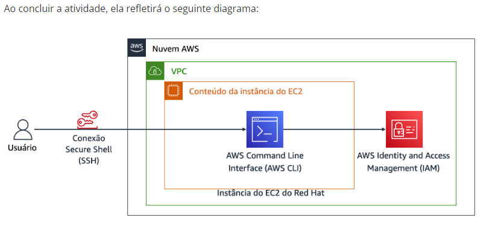

☁️ Instalação e Configuração da AWS CLI no Linux Red Hat

<strong>Laboratório prático de Cloud Computing | Amazon Web Services (AWS)</strong>

📌 Sobre o laboratório

Este projeto documenta a instalação e configuração da AWS Command Line Interface (AWS CLI) em uma instância Amazon EC2 executando Linux Red Hat.

Durante o laboratório, foi estabelecida uma conexão remota via SSH com uma instância EC2, realizada a instalação da AWS CLI, configuradas as credenciais de acesso à AWS e executadas consultas ao serviço AWS Identity and Access Management (IAM) por meio da linha de comando.

O objetivo foi compreender na prática como administrar e interagir com os serviços da AWS utilizando a AWS CLI.

🎯 Objetivos
Instalar a AWS CLI em uma instância Linux Red Hat.
Estabelecer conexão SSH com uma instância Amazon EC2.
Configurar as credenciais de acesso à conta AWS.
Compreender a estrutura de permissões do AWS IAM.
Consultar usuários do IAM utilizando comandos AWS CLI.
Validar a comunicação entre a instância EC2 e os serviços da AWS.
🛠️ Tecnologias e serviços utilizados
Tecnologia / Serviço	Descrição
Amazon EC2	Serviço de computação em nuvem utilizado para executar a instância Linux
Linux Red Hat	Sistema operacional da instância EC2
AWS CLI v2	Interface de linha de comando para interação com a AWS
AWS IAM	Serviço de gerenciamento de identidade e acesso
SSH	Protocolo utilizado para conexão remota
JSON	Formato utilizado para saída dos comandos da AWS CLI
🚀 Desenvolvimento do laboratório
1. Arquitetura do ambiente

O laboratório utiliza uma instância EC2 executando Linux Red Hat dentro de uma VPC da AWS.

A conexão com a instância é realizada por SSH. Após a instalação e configuração da AWS CLI, a instância consegue interagir com os serviços AWS, especialmente o IAM.

Diagrama da arquitetura

!Diagrama da arquitetura AWS

2. Conexão SSH com a instância EC2

Inicialmente, foi realizado o acesso ao ambiente AWS pelo Console de Gerenciamento.

Após iniciar o laboratório, foram obtidos o endereço IP público da instância EC2 e o arquivo de chave privada disponibilizado pelo ambiente.

A conexão remota foi estabelecida utilizando SSH.

Evidência 01 — Instância EC2

Visualização das informações da instância EC2 e identificação do endereço IP público utilizado na conexão.

!Instância EC2

Evidência 02 — Conexão SSH estabelecida

Conexão remota realizada com sucesso na instância Linux Red Hat utilizando o usuário ec2-user.

!Conexão SSH

3. Instalação da AWS CLI

Para instalar a AWS CLI v2, foi realizado o download do pacote oficial disponibilizado pela Amazon.

Download do instalador:

bash
curl "https://awscli.amazonaws.com/awscli-exe-linux-x86_64.zip" -o "awscliv2.zip"

Descompactação do instalador:

bash
unzip -u awscliv2.zip

Instalação da AWS CLI:

bash
sudo ./aws/install

Após a instalação, foi realizada a validação da ferramenta.

Evidência 03 — Validação da AWS CLI

Comando utilizado:

bash
aws --version

O comando permite verificar a versão instalada da AWS CLI e confirmar que a ferramenta está disponível no terminal.

!Validação da AWS CLI

4. Análise das permissões do AWS IAM

No Console de Gerenciamento da AWS, foi acessado o serviço IAM para observar as configurações do usuário awsstudent.

Durante essa etapa, foi analisada a política lab_policy, responsável por conceder permissões específicas ao usuário dentro da conta AWS utilizada no laboratório.

Evidência 04 — Política de permissões IAM

Visualização da política lab_policy no formato JSON, permitindo observar as permissões concedidas ao usuário.

!Política IAM

Evidência 05 — Credenciais de segurança IAM

Na guia Security credentials, foram observadas as informações relacionadas às credenciais de acesso do usuário awsstudent.

Essa etapa permitiu compreender a relação entre as credenciais de acesso e a autenticação realizada pela AWS CLI.

!Credenciais IAM

5. Configuração da AWS CLI

Após verificar as informações do IAM, foi realizada a configuração da AWS CLI para estabelecer a comunicação com a conta AWS.

Comando utilizado:

bash
aws configure

Foram configurados os seguintes parâmetros:

Parâmetro	Configuração
AWS Access Key ID	Credencial disponibilizada pelo laboratório
AWS Secret Access Key	Chave secreta disponibilizada pelo laboratório
Default region name	us-west-2
Default output format	json

Para verificar as configurações realizadas, foram utilizados os comandos:

bash
aws configure get region

bash
aws configure get output

bash
aws configure list

Evidência 06 — Configuração da AWS CLI

Verificação dos parâmetros de configuração da AWS CLI, incluindo região padrão e formato de saída JSON.

!Configuração AWS CLI

6. Consulta aos usuários do IAM utilizando AWS CLI

Na última etapa, foi realizado um teste de comunicação entre a instância EC2 e o serviço AWS IAM.

Comando executado:

bash
aws iam list-users

O comando realiza uma consulta à API do IAM e retorna uma estrutura JSON contendo os usuários cadastrados na conta AWS, conforme as permissões disponíveis para as credenciais configuradas.

Evidência 07 — Consulta ao IAM via AWS CLI

Resultado da execução do comando aws iam list-users, demonstrando a comunicação entre a AWS CLI e o serviço IAM.

!Consulta aos usuários IAM

✅ Resultados alcançados

Ao concluir o laboratório, foram realizadas as seguintes atividades:

Instalação da AWS CLI v2 em uma instância Linux Red Hat.
Estabelecimento de conexão SSH com uma instância Amazon EC2.
Configuração das credenciais de acesso à AWS.
Verificação das permissões associadas ao usuário IAM.
Configuração da região padrão us-west-2.
Definição do formato de saída JSON.
Execução de consultas ao IAM utilizando a AWS CLI.
Validação da comunicação entre a instância EC2 e os serviços AWS.
📚 Aprendizados

Este laboratório proporcionou experiência prática com:

Administração de instâncias Linux na AWS.
Acesso remoto utilizando SSH.
Instalação e configuração da AWS CLI.
Autenticação e gerenciamento de credenciais AWS.
Conceitos de identidade e permissões com IAM.
Execução de comandos para interação com serviços AWS.
Interpretação de respostas JSON retornadas pela AWS CLI.
🎓 Informações acadêmicas

Instituição: Escola da Nuvem

Site: https://escoladanuvem.org/

Professor: Raphael Ohlsen

Atividade: Instalar e configurar a AWS CLI

Plataforma: Amazon Web Services (AWS)

🔐 Observações de segurança

Este projeto foi desenvolvido para fins educacionais.

As credenciais utilizadas durante o laboratório são temporárias e fornecidas pelo ambiente de treinamento.

Nenhuma chave secreta, senha ou arquivo de chave privada deve ser publicado neste repositório.

👨‍💻 Conclusão

A realização deste laboratório permitiu desenvolver conhecimentos práticos sobre a utilização da AWS CLI em ambientes Linux, além de compreender como realizar autenticação e interagir com os serviços da AWS por meio de comandos no terminal.

A atividade reforçou conceitos importantes de computação em nuvem, administração Linux, gerenciamento de identidades e controle de acesso utilizando AWS IAM.

<strong>☁️ AWS Cloud Computing | Prática e aprendizado contínuo</strong>

Desenvolvido como parte dos estudos de Cloud Computing na Escola da Nuvem.

